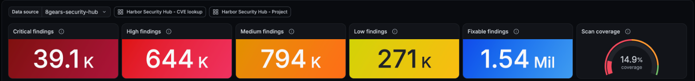
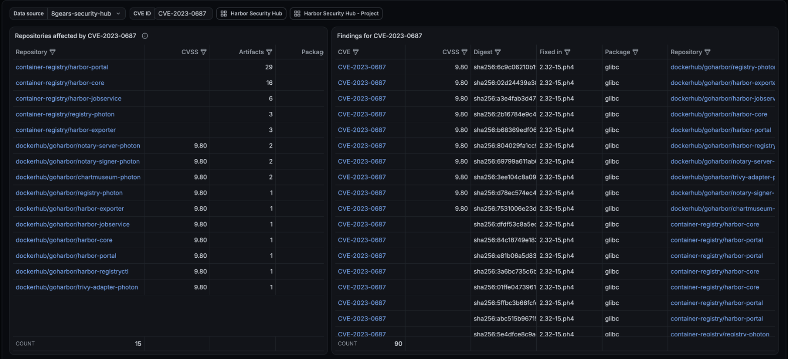
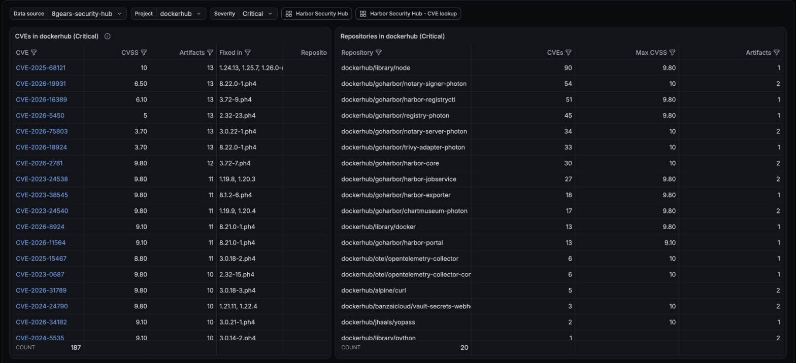

# Harbor Security Hub dashboards

Three linked Grafana dashboards that show the vulnerability data of a Harbor
instance: how exposed the registry is overall, where a given CVE is, and what a
project has to fix first.

| Dashboard | UID | Selector | Answers |
|-----------|-----|----------|---------|
| [Harbor Security Hub](../../deploy/chart/dashboards/harbor-security-hub.json) | `harbor-security-hub` | none | Totals per severity, fixable findings, scan coverage, top 5 CVEs and artifacts |
| [CVE lookup](../../deploy/chart/dashboards/harbor-security-hub-cve.json) | `harbor-security-hub-cve` | CVE ID | Which repositories and artifacts carry a CVE, and in which package |
| [Project](../../deploy/chart/dashboards/harbor-security-hub-project.json) | `harbor-security-hub-project` | Project, Severity | Which CVEs affect the most artifacts in a project, and which repositories carry them |

The dashboards read the [Security Hub API](../../api/v2.0/swagger.yaml)
(`/security/summary`, `/security/vul`) through the
[Infinity datasource](https://grafana.com/grafana/plugins/yesoreyeram-infinity-datasource/).
Every panel queries Harbor live when it loads. Nothing is scraped or stored, so
the time picker is hidden and has no effect. For time series of Harbor itself,
use the [Harbor dashboard](README.md).

## Preview

Overview:



CVE lookup:



Project:



## Navigation

Each dashboard has its selectors directly above the panels they drive. Click
through instead of scrolling:

- A **CVE** opens a menu: **Where is this CVE?** opens the CVE lookup for it,
  **Open in NVD** opens the NVD entry.
- A **Repository** opens the Project dashboard for its project at Critical.
- The link bar at the top switches between the three dashboards. The selected
  data source is carried along.

## Prerequisites

- Harbor 2.9 or later with a default vulnerability scanner. Only reports of the
  default scanner are counted.
- The Infinity datasource plugin in Grafana. Tested with Infinity 4.1.6 on Grafana 13.
- A robot account with read access to the Security Hub. Security Hub is a
  system-level resource, so a **system administrator** has to create it.

### Robot account

Create a system robot account with only these permissions:

| Resource | Actions | Used for |
|----------|---------|----------|
| Security Hub | Read, List | `/security/summary`, `/security/vul` |
| Project | List | The Project selector |

In the portal, open **Administration → Robot Accounts → New Robot Account**,
select **Security Hub** and **Project** under the system permissions, and leave
the project list empty. With the API:

```sh
curl -u admin -X POST https://harbor.example.com/api/v2.0/robots \
  -H 'Content-Type: application/json' -d '{
    "name": "grafana-security-hub",
    "description": "Grafana Security Hub dashboards (read-only)",
    "level": "system",
    "duration": -1,
    "permissions": [{"kind": "system", "namespace": "/", "access": [
      {"resource": "security-hub", "action": "read"},
      {"resource": "security-hub", "action": "list"},
      {"resource": "project", "action": "list"}]}]}'
```

The response holds the robot's full name, including its prefix (default `robot$`),
and its secret. The robot cannot pull, push or change anything.
`"duration": -1` means it never expires. Choose an expiry instead if your policy
requires rotation, and update the datasource when you refresh the secret.

### Infinity datasource

Create an Infinity datasource with:

| Setting | Value |
|---------|-------|
| Base URL | `https://harbor.example.com/api/v2.0` |
| Authentication | Basic authentication, the robot's full name and secret |
| Allowed hosts | `https://harbor.example.com` |

The panels use relative URLs such as `/security/vul`, so the Harbor address
comes only from the datasource. One datasource per Harbor instance; pick it in
the **Data source** selector.

Anyone who can query this datasource sees the vulnerability data of every
project, with the robot's permissions rather than their own. Restrict the
datasource and the dashboard folder with Grafana permissions if that is not
intended.

## Import and provisioning

1. Download the three `deploy/chart/dashboards/harbor-security-hub*.json` files.
2. In Grafana, open **Dashboards → New → Import** and import each file.
3. Choose the Infinity **Data source** at the top.

Import all three: the data links between them use the fixed UIDs above.

With the [Harbor Next Helm chart](../../deploy/chart/README.md), set
`metrics.grafanaDashboard.securityHub.enabled: true`. The chart ships the three
files in a second ConfigMap with the namespace, labels and annotations of
`metrics.grafanaDashboard`, for the same dashboard sidecar. It does not need
`metrics.enabled` and does not create the robot or the datasource.

## Reading the numbers

- **Findings, not CVEs.** The severity tiles sum the reports of all scanned
  artifacts. A CVE in a base image used by 300 artifacts counts 300 times.
- **Scan coverage is a lower bound.** It divides scanned artifacts by every
  artifact row, which includes signatures, SBOMs and index children that are
  never scanned.
- **Severity and CVSS can disagree.** Severity is what the scanner reports, often
  from the distribution's advisory. CVSS is the NVD v3 score, empty when the
  scanner has none.
- **Every stored artifact counts,** including old tags nobody pulls.
- **Duplicates collapse.** The API can return identical rows for one package;
  the tables show them once.

## Limits

- Each table shows at most 1000 findings (10 pages of 100, the API maximum).
  Every page is a separate query because Infinity's built-in pagination fails on
  Harbor's empty last page.
- The Project selector lists the first 100 projects.
- Filters are exact matches. An empty CVE ID returns HTTP 400, so the CVE lookup
  always needs a value.
- Project-filtered queries scan the vulnerability tables and take a few seconds
  per page on large instances.
- Project members without system access cannot use these dashboards with their
  own credentials: the Security Hub API requires system-level access.

## Why not Prometheus metrics

Per-CVE metrics need one series per project, repository and CVE. That grows
with images times CVEs, churns with every vulnerability database update, and
runs a large join on the Harbor database on every scrape. The Security Hub API
answers the same questions on demand, only when someone looks. Aggregates such
as findings per project and severity remain a good fit for metrics and alerting.

## Editing

Edit the JSON files directly, or import them, edit in Grafana and export the
classic dashboard JSON back. Before saving an export:

- Keep the three UIDs, titles, the `harbor-security-hub` tag and panel IDs. The
  link bar and the data links depend on them.
- Keep `${datasource}` in every target and in the data links
  (`var-datasource=${datasource}`).
- Keep the ten page queries (refIds `A` to `J`) and the `merge` transformation in
  each table.
- Remove the Grafana database `id` and revision `version`, and clear every
  variable's `current` to `{}` and `options` to `[]`.

Then run the chart checks from the repository root:

```sh
task helm:helm-lint helm:helm-template helm:unittest helm:examples
```
